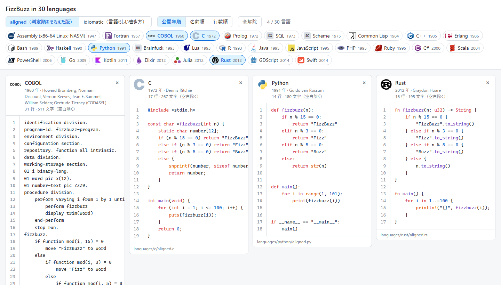

English | [日本語](README.md)

# FizzBuzz in 30 languages

FizzBuzz written in 30 programming languages.\
Each language has two versions: one that follows the same steps in every language, and one written the way that language likes to be written.\
All 60 programs were actually run, and every one prints the same 100 lines.



## Compare them

Open [`compare.html`](compare.html) in a browser to put the code of the languages you pick side by side.

- Toggle aligned and idiomatic separately for each language to compare both side by side. Each column's × removes only that pair
- “Select all aligned” and “Select all idiomatic” add that version. “Select all (both)” and “Clear all” act on all pairs
- The default shows both versions of C, Python and COBOL. Sort by year, name or each version's line count
- Columns fit their longest code line and wrap onto new rows. Only columns wider than the screen scroll internally
- Share selections by URL (e.g. `compare.html#s=year&p=c:aligned,c:idiomatic,python:aligned`). Old links such as `#v=aligned&l=c,python,cobol` still work
- Use `?lang=ja` or `?lang=en` to set the display language. Otherwise, Japanese browsers use Japanese and all others use English. This works with the selection in `#`.

No server is needed. Just double-click the file.


## Two versions

| Version | What it is |
|---|---|
| **aligned** | The same flow in every language. A function checks 15 → 3 → 5 → the number, in that order, and a loop calls it |
| **idiomatic** | The way each language likes to be written: pattern matching, comprehensions, pipes and so on |

Both print 1 to 100, one per line. The code has no comments.

For languages that cannot follow the aligned shape directly:

- **SQL**: SQLite's `CASE` expression stands in for the function
- **COBOL**: a paragraph that sets a string stands in for the function
- **Bash**: standard output stands in for the function's return value
- **Haskell, Prolog**: `mapM_` and `forall/2` stand in for the loop
- **Brainfuck**: there is no division, so it counts down from 3 and 5. Both versions are the same code

## Languages

The year is the "first appeared" year on English Wikipedia (Batch uses the MS-DOS 1.0 lineage year, 1981). Line counts exclude blank lines.

| Language | Year | aligned | idiomatic |
|---|---|---|---|
| Assembly (x86-64 Linux; NASM) | 1947 | [61 lines](languages/asm/aligned.asm) | [64 lines](languages/asm/idiomatic.asm) |
| Fortran | 1957 | [23 lines](languages/fortran/aligned.f90) | [12 lines](languages/fortran/idiomatic.f90) |
| COBOL | 1960 | [31 lines](languages/cobol/aligned.cob) | [24 lines](languages/cobol/idiomatic.cob) |
| C | 1972 | [17 lines](languages/c/aligned.c) | [17 lines](languages/c/idiomatic.c) |
| Prolog | 1972 | [12 lines](languages/prolog/aligned.pl) | [9 lines](languages/prolog/idiomatic.pl) |
| SQL | 1973 | [13 lines](languages/sql/aligned.sql) | [14 lines](languages/sql/idiomatic.sql) |
| Scheme | 1975 | [13 lines](languages/scheme/aligned.scm) | [11 lines](languages/scheme/idiomatic.scm) |
| Common Lisp | 1984 | [12 lines](languages/commonlisp/aligned.lisp) | [11 lines](languages/commonlisp/idiomatic.lisp) |
| C++ | 1985 | [13 lines](languages/cpp/aligned.cpp) | [16 lines](languages/cpp/idiomatic.cpp) |
| Erlang | 1986 | [13 lines](languages/erlang/aligned.erl) | [13 lines](languages/erlang/idiomatic.erl) |
| Bash | 1989 | [15 lines](languages/bash/aligned.sh) | [9 lines](languages/bash/idiomatic.sh) |
| Batch | 1981 | [18 lines](languages/batch/aligned.bat) | [14 lines](languages/batch/idiomatic.bat) |
| PowerShell | 2006 | [14 lines](languages/powershell/aligned.ps1) | [8 lines](languages/powershell/idiomatic.ps1) |
| Haskell | 1990 | [9 lines](languages/haskell/aligned.hs) | [8 lines](languages/haskell/idiomatic.hs) |
| Python | 1991 | [14 lines](languages/python/aligned.py) | [7 lines](languages/python/idiomatic.py) |
| Brainfuck | 1993 | [36 lines](languages/brainfuck/aligned.bf) | [36 lines](languages/brainfuck/idiomatic.bf) |
| Lua | 1993 | [14 lines](languages/lua/aligned.lua) | [17 lines](languages/lua/idiomatic.lua) |
| R | 1993 | [14 lines](languages/r/aligned.R) | [8 lines](languages/r/idiomatic.R) |
| Java | 1995 | [13 lines](languages/java/aligned.java) | [14 lines](languages/java/idiomatic.java) |
| JavaScript | 1995 | [12 lines](languages/javascript/aligned.js) | [9 lines](languages/javascript/idiomatic.js) |
| PHP | 1995 | [13 lines](languages/php/aligned.php) | [11 lines](languages/php/idiomatic.php) |
| Ruby | 1995 | [17 lines](languages/ruby/aligned.rb) | [8 lines](languages/ruby/idiomatic.rb) |
| C# | 2000 | [14 lines](languages/csharp/aligned.cs) | [16 lines](languages/csharp/idiomatic.cs) |
| Go | 2009 | [21 lines](languages/go/aligned.go) | [22 lines](languages/go/idiomatic.go) |
| Kotlin | 2011 | [11 lines](languages/kotlin/aligned.kt) | [9 lines](languages/kotlin/idiomatic.kt) |
| Elixir | 2012 | [21 lines](languages/elixir/aligned.exs) | [13 lines](languages/elixir/idiomatic.exs) |
| Julia | 2012 | [14 lines](languages/julia/aligned.jl) | [6 lines](languages/julia/idiomatic.jl) |
| Rust | 2012 | [16 lines](languages/rust/aligned.rs) | [13 lines](languages/rust/idiomatic.rs) |
| GDScript | 2014 | [14 lines](languages/gdscript/aligned.gd) | [11 lines](languages/gdscript/idiomatic.gd) |
| Swift | 2014 | [14 lines](languages/swift/aligned.swift) | [9 lines](languages/swift/idiomatic.swift) |

Designers and logo sources are listed in [`data/languages.csv`](data/languages.csv).

## Folder layout

```
compare.html   The compare page (generated by scripts/build_compare.py)
languages/     Code for 30 languages, two files each: aligned and idiomatic
data/          Language data, line and character counts, expected output, logos
scripts/       Scripts to run, check and generate
docs/          Run results and language data sources
```

## Run them all

On WSL Ubuntu 22.04 (x86-64), run these from the repository folder.

```sh
sudo bash scripts/setup.sh         # install the toolchains with apt
python3 scripts/setup_portable.py  # unpack Swift, Julia, PowerShell and Godot into .runtimes/
bash scripts/run_all.sh            # build and run 58 (Batch is skipped), and compare with the expected output
```

- Results are written to [`docs/results.md`](docs/results.md)
- If any output differs or any program fails, the exit code is 1
- Build commands, output and diffs are kept in `.build/<language>/<version>/`
- What the scripts check is listed in [`docs/checks.md`](docs/checks.md) (Japanese)

Batch uses 1981 for the MS-DOS 1.0 lineage. It uses Windows cmd subroutines and standard output. Linux verifies 58 programs and skips Batch. Run these on Windows and compare with data/expected.txt after normalizing CRLF/LF.

```bat
cmd /c languages\batch\aligned.bat
cmd /c languages\batch\idiomatic.bat
```

## Rebuild the compare page

After changing the code or `data/languages.csv`, rebuild `compare.html` with:

```sh
python3 scripts/build_compare.py
```

Change the look in [`scripts/compare.template.html`](scripts/compare.template.html).

## License

- **Code**: [MIT License](LICENSE)
- **Logos**: each follows the license of its source
  - 25 languages use SVGs from [Devicon](https://devicon.dev/) (MIT, see [`data/logos/DEVICON-LICENSE.txt`](data/logos/DEVICON-LICENSE.txt))
  - Batch uses a self-made SVG (CC0)
  - Common Lisp uses an SVG from lisp-lang.org (the source does not state a license)
  - SQL, Scheme and Brainfuck have no logo
  - The source URL of each logo is in the `logo_source_url` column of [`data/languages.csv`](data/languages.csv)
