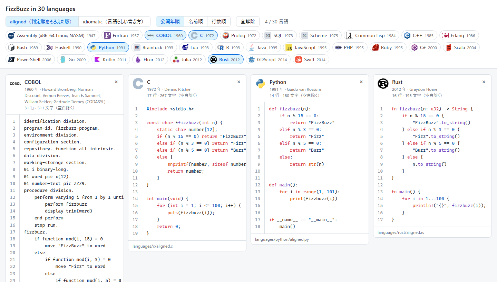

[English](README.en.md) | 日本語

# FizzBuzz in 30 languages

FizzBuzz を 30 種類のプログラミング言語で書いたサンプル集です。\
1 つの言語につき、判定の順番をそろえた版と、その言語らしい書き方の版の 2 本を置いています。\
60 本とも実際に動かし、出力が同じ 100 行になることを確かめています。



## 見比べる

[`compare.html`](compare.html) をブラウザで開くと、選んだ言語のコードを横に並べて見比べられます。

- 上の一覧で言語を選ぶと、列が増えます
- `aligned` / `idiomatic` を切り替えられます
- 公開年順・名前順・行数順に並べ替えられます
- 選んだ状態は URL の `#` 以降に入るので、そのまま共有できます（例: `compare.html#v=aligned&l=c,python,cobol`）

サーバーは不要で、ファイルをダブルクリックすれば開けます。

## 2 つの版

| 版 | 内容 |
|---|---|
| **aligned** | 全言語で同じ流れにそろえた版。関数で 15 → 3 → 5 → 数字 の順に判定し、ループから呼び出す |
| **idiomatic** | その言語らしい書き方の版。パターンマッチ・内包表記・パイプなど、言語ごとの得意な書き方を使う |

どちらも 1〜100 を 1 行ずつ出力します。コードにコメントは入れていません。

aligned の形にそのまま書けない言語は、次のようにしています。

- **SQL**: 関数の代わりに SQLite の `CASE` 式を使う
- **COBOL**: 文字列を設定する段落を、関数の代わりにする
- **Bash**: 標準出力を、関数の返り値の代わりにする
- **Haskell・Prolog**: ループの代わりに `mapM_`・`forall/2` を使う
- **Brainfuck**: 割り算がないので、3 と 5 のカウントダウンで判定する。2 つの版は同じコード

## 収録言語

公開年は英語版 Wikipedia の first appearance です。行数は空行を除いた数です。

| 言語 | 公開年 | aligned | idiomatic |
|---|---|---|---|
| Assembly (x86-64 Linux; NASM) | 1947 | [61 行](languages/asm/aligned.asm) | [64 行](languages/asm/idiomatic.asm) |
| Fortran | 1957 | [23 行](languages/fortran/aligned.f90) | [12 行](languages/fortran/idiomatic.f90) |
| COBOL | 1960 | [31 行](languages/cobol/aligned.cob) | [24 行](languages/cobol/idiomatic.cob) |
| C | 1972 | [17 行](languages/c/aligned.c) | [17 行](languages/c/idiomatic.c) |
| Prolog | 1972 | [12 行](languages/prolog/aligned.pl) | [9 行](languages/prolog/idiomatic.pl) |
| SQL | 1973 | [13 行](languages/sql/aligned.sql) | [14 行](languages/sql/idiomatic.sql) |
| Scheme | 1975 | [13 行](languages/scheme/aligned.scm) | [11 行](languages/scheme/idiomatic.scm) |
| Common Lisp | 1984 | [12 行](languages/commonlisp/aligned.lisp) | [11 行](languages/commonlisp/idiomatic.lisp) |
| C++ | 1985 | [13 行](languages/cpp/aligned.cpp) | [16 行](languages/cpp/idiomatic.cpp) |
| Erlang | 1986 | [13 行](languages/erlang/aligned.erl) | [13 行](languages/erlang/idiomatic.erl) |
| Bash | 1989 | [15 行](languages/bash/aligned.sh) | [9 行](languages/bash/idiomatic.sh) |
| Haskell | 1990 | [9 行](languages/haskell/aligned.hs) | [8 行](languages/haskell/idiomatic.hs) |
| Python | 1991 | [14 行](languages/python/aligned.py) | [7 行](languages/python/idiomatic.py) |
| Brainfuck | 1993 | [36 行](languages/brainfuck/aligned.bf) | [36 行](languages/brainfuck/idiomatic.bf) |
| Lua | 1993 | [14 行](languages/lua/aligned.lua) | [17 行](languages/lua/idiomatic.lua) |
| R | 1993 | [14 行](languages/r/aligned.R) | [8 行](languages/r/idiomatic.R) |
| Java | 1995 | [13 行](languages/java/aligned.java) | [14 行](languages/java/idiomatic.java) |
| JavaScript | 1995 | [12 行](languages/javascript/aligned.js) | [9 行](languages/javascript/idiomatic.js) |
| PHP | 1995 | [13 行](languages/php/aligned.php) | [11 行](languages/php/idiomatic.php) |
| Ruby | 1995 | [17 行](languages/ruby/aligned.rb) | [8 行](languages/ruby/idiomatic.rb) |
| C# | 2000 | [14 行](languages/csharp/aligned.cs) | [16 行](languages/csharp/idiomatic.cs) |
| Scala | 2004 | [13 行](languages/scala/aligned.scala) | [9 行](languages/scala/idiomatic.scala) |
| PowerShell | 2006 | [14 行](languages/powershell/aligned.ps1) | [8 行](languages/powershell/idiomatic.ps1) |
| Go | 2009 | [21 行](languages/go/aligned.go) | [22 行](languages/go/idiomatic.go) |
| Kotlin | 2011 | [11 行](languages/kotlin/aligned.kt) | [9 行](languages/kotlin/idiomatic.kt) |
| Elixir | 2012 | [21 行](languages/elixir/aligned.exs) | [13 行](languages/elixir/idiomatic.exs) |
| Julia | 2012 | [14 行](languages/julia/aligned.jl) | [6 行](languages/julia/idiomatic.jl) |
| Rust | 2012 | [16 行](languages/rust/aligned.rs) | [13 行](languages/rust/idiomatic.rs) |
| GDScript | 2014 | [14 行](languages/gdscript/aligned.gd) | [11 行](languages/gdscript/idiomatic.gd) |
| Swift | 2014 | [14 行](languages/swift/aligned.swift) | [9 行](languages/swift/idiomatic.swift) |

設計者とロゴの出典は [`data/languages.csv`](data/languages.csv) にまとめています。

## フォルダ構成

```
compare.html   比較ページ（scripts/build_compare.py で生成）
languages/     30 言語のコード。言語ごとに aligned と idiomatic の 2 本
data/          言語データ・行数と文字数・正しい出力・ロゴ
scripts/       実行・検証・生成のスクリプト
docs/          実行結果・言語データの出典
```

## 全部動かして確かめる

WSL の Ubuntu 22.04（x86-64）で、リポジトリのフォルダから次のコマンドを実行します。

```sh
sudo bash scripts/setup.sh         # apt で処理系を入れる
python3 scripts/setup_portable.py  # Swift・Julia・PowerShell・Godot を .runtimes/ に展開する
bash scripts/run_all.sh            # 60 本をビルド・実行して、正しい出力と比べる
```

- 結果は [`docs/results.md`](docs/results.md) に書き出されます
- 1 本でも出力が違うか失敗すると、終了コードが 1 になります
- ビルドのコマンド・出力・差分は `.build/<言語>/<版>/` に残ります
- 何を検査しているかは [`docs/checks.md`](docs/checks.md) にまとめています

## 比較ページを作り直す

コードや `data/languages.csv` を変えたら、次のコマンドで `compare.html` を作り直します。

```sh
python3 scripts/build_compare.py
```

見た目は [`scripts/compare.template.html`](scripts/compare.template.html) で変えられます。

## ライセンス

- **コード**: [MIT License](LICENSE)
- **ロゴ**: それぞれの配布元のライセンスに従います
  - 26 言語は [Devicon](https://devicon.dev/) の SVG です（MIT。[`data/logos/DEVICON-LICENSE.txt`](data/logos/DEVICON-LICENSE.txt)）
  - Common Lisp は lisp-lang.org の SVG です（配布元にライセンスの記載はありません）
  - SQL・Scheme・Brainfuck はロゴがありません
  - 各ロゴの出典 URL は [`data/languages.csv`](data/languages.csv) の `logo_source_url` 列にあります
